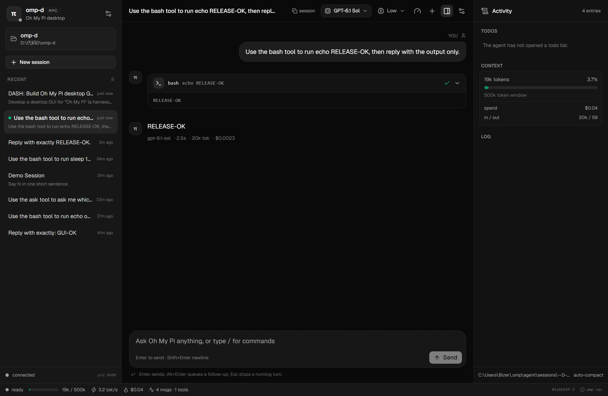

# omp-d

A desktop window for [Oh My Pi](https://github.com/can1357/oh-my-pi) — the `omp` coding agent. Built with Tauri 2, React 19, Rust, and shadcn/ui on Base UI.

The app spawns a local `omp --mode rpc-ui` process and speaks its newline-delimited JSON RPC protocol over stdio. Sessions, tools, TODOs, artifacts and settings remain in Oh My Pi's own storage; the window is a client, not a replacement runtime.



## Features

- Streaming chat with assistant text, thinking blocks, tool calls, ANSI-stripped terminal output, and edit diffs.
- Inline raster/SVG image blocks, SVG and Mermaid code-fence figures, and previews of written `.svg`, `.mmd` and `.mermaid` files. SVG figures resolve OMP theme tokens and remain isolated from app HTML. Numeric comparison tables get a supplemental chart when their values have compatible units; ambiguous tables remain tables. Figures render while SVG source streams; incomplete Mermaid and invalid figures retain readable source.
- Session browser: resume/switch existing sessions, start new ones, rename, and reopen the active session after a restart or crash.
- Message forks use omp's `/tree` mechanism in the current session file: the pencil edits a sent user message, and **Save & fork** sends that edited prompt to the running agent. Later prompts continue that branch normally. Original replies remain in the same session and can be restored with the arrows beside `1/3`; switching does not regenerate them. Cancel leaves history unchanged; attachments are retained. Editing and switching wait until the agent and its queues are idle.
- Shared `/model` and `/models` page with providers on the left, configured roles and models on the right, model-kind filters, search, keyboard navigation, and live-session switching. Project/profile-scoped cached catalogs render immediately; CLI discovery refreshes in the background. Role queries use project/profile settings; `--config` role overlays are unsupported by the CLI and produce a visible warning.
- Unauthenticated/unavailable providers remain visible below available providers. Their full registry catalogs can be browsed, but model selection stays disabled until credentials/configuration are ready and the catalog is refreshed.
- Composer with Enter/Shift+Enter, steering and follow-up queues, queued-message chips, Esc abort, image paste, and slash-command autocomplete.
- Goal commands: `/goal <objective>` or `/goal set <objective>` starts a goal; `/goal` and `/goal show` display it; `/goal pause`, `/goal resume`, and `/goal drop` manage its lifecycle. Inspector shows the objective and task progress. Budget editing and `/guided-goal` require runtime RPC operations that are not currently available.
- Extension UI dialogs for `select`, `confirm`, `input`, `editor` and `ask`, plus `notify`, status marks and widgets.
- Compact Inspector with goal/task progress, Main activity, live subagent status and tool activity, Git file summaries, and a context footer. Tasks, agents, and file diffs open in the main workspace. Click **Context** to see token counts and estimated cost in a popover. Completed agents collapse into a count. Short windows reduce row detail.
- Click **Plan usage** above **Context**, or enter `/usage`, to see account quotas and reset times without sending a message. The popover uses the configured omp’s `usage --json` command. Multiple accounts are listed separately because omp’s desktop RPC does not identify the account selected for a request.
- Changes can be filtered to files with recorded successful session edits or the full working tree. Both scopes show the current net Git diff against HEAD, including staged/unstaged edits; session scope is file attribution, not a session-only patch. Shell-based edits without structured file metadata cannot be attributed. Git queries are read-only and bounded; binary files and oversized diffs are reported explicitly.
- Embedded PTY terminal with shell tabs, scrollback, drag/keyboard resizing, maximize/restore, and `Ctrl+backtick` (`Cmd+backtick` on macOS). Hidden terminals keep running.
- Native `/settings` editor: searchable catalog from the configured omp installation, native categories and enum choices, typed scalar/JSON editors, masked credentials, and per-setting global Save/Reset. Effective project/environment values are shown separately from global drafts. Desktop launch preferences remain in a separate tab.
- Process supervision: v1/v2 RPC framing, chunk reassembly, crash detection, clean shutdown, and restart that preserves the current session.

## Requirements

- An `omp` installation on `PATH` (or an absolute binary path configured in Settings).
- [Bun](https://bun.sh) 1.4+ for the frontend and Tauri CLI.
- Rust 1.85+ with a C++ build toolchain for Tauri. On Windows: MSVC 2022 and WebView2.
- Linux/macOS need the usual [Tauri prerequisites](https://tauri.app/start/prerequisites/); this repository is developed and tested on Windows.

## Run it

```bash
bun install
bun tauri dev
```

The first launch opens a folder picker. That directory becomes the agent's `--cwd` and its own session bucket. For development, `OMPD_CWD=/path/to/project` skips the picker on first launch.

`bun tauri dev` disables the Tauri and Vite file watchers. When `/wt <branch>`
rewrites the source checkout, the desktop window and its agent stay running;
the app updates workspace data in place. Restart the development app after
source changes. Use `bunx tauri dev` to opt into both watchers, or `bun run dev`
for frontend-only hot reload.

## Build

```bash
bun run build              # typecheck + frontend production build
bun tauri build --no-bundle # release binary without installers
bun tauri build            # installers (MSI/NSIS on Windows)
```

The bundled app expects `omp` on `PATH` unless the Settings dialog stores a different binary.

Open Settings from the toolbar, `Ctrl+,` (`Cmd+,` on macOS), or `/settings`.
The Oh My Pi tab reads every option exposed by `omp config list --json`,
including options outside the TUI's usual tabs. Save writes to native global
`config.yml`; Reset removes that global override without changing project
configuration. Reload discards unsaved drafts. Restart the agent after saving
to apply changes to the running session. Terminal appearance options configure
the TUI, not the desktop renderer. Launcher `--config` overlays cannot be edited
or included in queries through the native config CLI; the page warns when used.
The Desktop & runtime tab retains binary, model, extra arguments, theme and
process diagnostics.

## Embedded terminal

Click **Terminal** in the status bar or press `Ctrl+backtick` (`Cmd+backtick`
on macOS). The first shell starts only when opened, in the active workspace.
Windows uses `COMSPEC` (normally `cmd.exe`); Linux/macOS use `SHELL`, falling
back to `/bin/sh`.

Use **+** for independent shells and **×** to terminate a shell and its children.
The down arrow hides the panel without stopping commands or clearing scrollback.
Changing workspace or closing the app terminates its terminals; changing chat
sessions does not. Exited tabs retain their output and exit code.

Drag the top edge to resize. With that separator focused, use Up/Down
(`Shift` for larger steps), Home or End. The maximize button fills the central
workspace; restore returns to the previous height. Normal terminal input,
including `Ctrl+C`, goes directly to the shell. Terminals run with your account's
permissions, independently of the agent, and require the desktop app.

## Diagnostics

Desktop diagnostics belong to `~/.omp/ompd/dev/` for debug builds and
`~/.omp/ompd/release/` for release builds, independently of workspace and omp's
session storage. `logs/` contains background-written JSONL; `profiles/` contains
opt-in Rust profiling captures. Each launch has its own run ID.

Set `OMPD_LOG` to a tracing filter (default `info`) before starting the app.
Set `OMPD_PROFILE=1` to enable Puffin capture, then close the app normally to
finish the capture. Open the resulting `.puffin` file with `puffin_viewer`.
Use a release build when comparing performance; debug/HMR measurements are
separate. Forced termination can lose buffered logs and unfinished captures.

Instrumentation lives at startup, the shared frontend IPC bridge, native command
dispatch and agent transport. Ordinary features use the shared bridge without
adding diagnostics calls. IPC timing includes native execution and transport;
Puffin's `ipc_dispatch` scope measures synchronous dispatch only, not completion
of asynchronous commands. Rust scopes never span `.await`. Puffin does not
measure React rendering or code inside the omp child.

IPC successes are sampled once per operation per second, with a global limit
of 20 successful reports and 10 error reports per second, and at most eight
reports in flight. These records are diagnostic samples, not complete metrics
for percentile or failure-rate calculations.

Logs rotate at 8 MiB per file and retain 24 files per environment; the background
queue holds 4096 events and drops excess traffic under load. Only application
logging targets are persisted. Profiling keeps the newest 120 frames at a
100 ms collection interval, within a 32 MiB frame-data budget, and retains eight
capture/partial files. Export is capped at 64 MiB per capture; this is a recent
activity window, not a recording of the entire application lifetime.

Persistent events contain operation metadata and timings, not command arguments,
responses, prompt text, raw child stderr or frontend exception messages/stacks.
The existing in-memory process diagnostics remain available in Settings.
Treat captures and logs as local diagnostic data; inspect them before sharing.

## Architecture

```
React UI  ──invoke / omp:// events──▶  Rust supervisor  ──stdin/stdout JSONL──▶  omp --mode rpc-ui
```

- `src-tauri/src/rpc_frame.rs` validates protocol-v2 chunk sequences and reassembles large frames.
- `src-tauri/src/agent.rs` owns the child process, request stdin, stderr diagnostics, generation tagging, start/stop serialization, and an exit monitor that polls the direct child because tool subprocesses can keep stdout pipes open.
- `src-tauri/src/sessions.rs` discovers the main checkout and linked worktrees, maps each directory to Oh My Pi's session bucket, and reads bounded metadata for the grouped recent-session list.
- `src/lib/omp/client.ts` handles ready/process lifecycle, request correlation, and v2 negotiation.
- `src/lib/omp/store.ts` projects RPC events into chat messages, streaming snapshots, tool runs, queues, dialogs, notices and session state.
- `src/components/app/*` is the UI; `src/components/ui/*` is the shadcn Base UI set.

See [docs/architecture.md](docs/architecture.md) for the lifecycle and failure handling details.

## Transport

RPC, not ACP: `omp --mode rpc-ui` exposes the session, model, queue, TODO, extension-UI and tool-event surface this UI needs, while ACP is shaped for editor clients. The full protocol schema lives in the installed package at `src/modes/rpc/rpc-types.ts`; the subset used here is mirrored in `src/lib/omp/types.ts`.

Protocol v1 is the baseline. The client negotiates v2 after `ready`, letting frames larger than 1 MiB arrive as validated `rpc_chunk` segments (up to 64 MiB reassembled).

## Limitations

- Live subagent status and child transcripts require `set_subagent_subscription`, `get_subagents` and `get_subagent_messages`. Older runtimes retain clearly marked task snapshots. No `/btw` side questions, voice or dictation.
- No host-tool or host-URI registration.
- RPC mode has no approval request, so the UI does not show approve/deny prompts; it inherits the launch policy of the `omp` child.
- One agent process per window. Session switching aborts an in-flight turn, as the RPC command does.
- Image attachments are supported through paste; files are not attached through the picker yet.
- The transcript is loaded in one `get_messages` response; extremely long sessions can take a moment to hydrate.
- Tree navigation requires an omp version with `get_entries` and `navigate_tree`. Branch metadata loads separately and does not disable typing, sending or stopping the agent. As in omp's tree UI, selecting a branch that ended on an unanswered user message restores that prompt to the composer.

## Tests

```bash
cargo test --manifest-path src-tauri/Cargo.toml
bun test tests/branches.test.ts tests/store-sessions.test.ts
bun run build
```

The Rust tests cover chunk reassembly, malformed sequences, session bucket encoding and title-slot parsing. UI behavior was exercised against a live local `omp` instance: streaming, tool calls, steering/follow-up queues, abort, ask dialogs, model listing, session switching, rename, settings restart and crash recovery.

## License

Apache-2.0. See [LICENSE](LICENSE).
