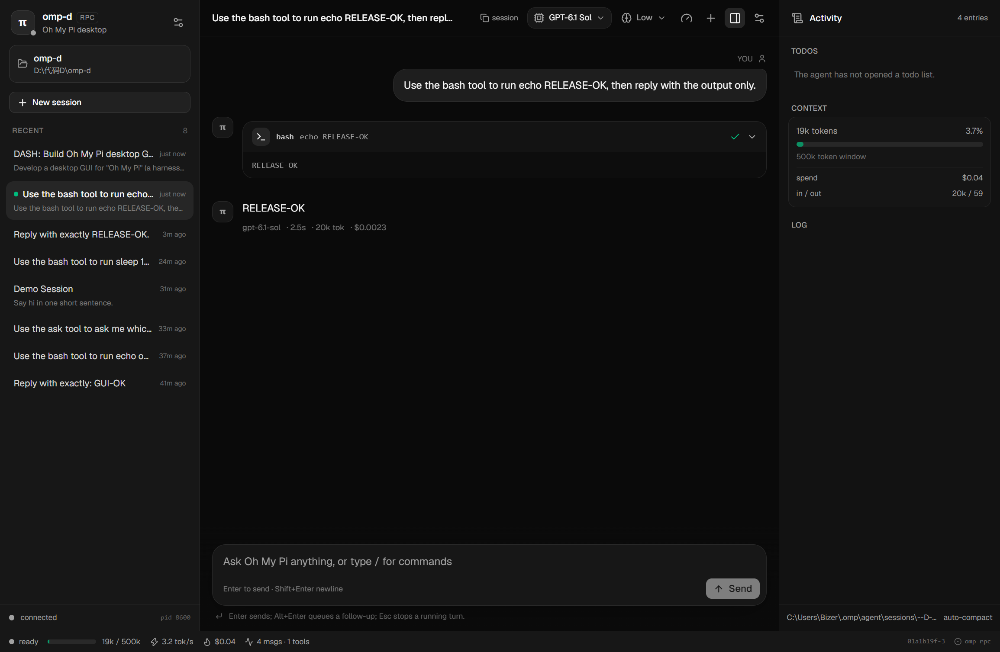

# omp-d

A desktop window for [Oh My Pi](https://github.com/can1357/oh-my-pi) — the `omp` coding agent. Built with Tauri 2, React 19, Rust, and shadcn/ui on Base UI.

The app spawns a local `omp --mode rpc-ui` process and speaks its newline-delimited JSON RPC protocol over stdio. Sessions, tools, TODOs, artifacts and settings remain in Oh My Pi's own storage; the window is a client, not a replacement runtime.



## Features

- Streaming chat with assistant text, thinking blocks, tool calls, ANSI-stripped terminal output, and edit diffs.
- Session browser: resume/switch existing sessions, start new ones, rename, and reopen the active session after a restart or crash.
- Model picker backed by `get_available_models`, thinking-level menu, context/token/cost readouts.
- Composer with Enter/Shift+Enter, steering and follow-up queues, queued-message chips, Esc abort, image paste, and slash-command autocomplete.
- Extension UI dialogs for `select`, `confirm`, `input`, `editor` and `ask`, plus `notify`, status marks and widgets.
- Activity rail with TODOs, running tools, context usage, spend and agent notices.
- Process supervision: v1/v2 RPC framing, chunk reassembly, crash detection, clean shutdown, and restart that preserves the current session.

## Requirements

- An `omp` installation on `PATH` (or an absolute binary path configured in Settings).
- [Bun](https://bun.sh) 1.4+ for the frontend and Tauri CLI.
- Rust 1.85+ with a C++ build toolchain for Tauri. On Windows: MSVC 2022 and WebView2.
- Linux/macOS need the usual [Tauri prerequisites](https://tauri.app/start/prerequisites/); this repository is developed and tested on Windows.

## Run it

```bash
bun install
bun tauri dev
```

The first launch opens a folder picker. That directory becomes the agent's `--cwd` and its own session bucket. For development, `OMPD_CWD=/path/to/project` skips the picker on first launch.

## Build

```bash
bun run build              # typecheck + frontend production build
bun tauri build --no-bundle # release binary without installers
bun tauri build            # installers (MSI/NSIS on Windows)
```

The bundled app expects `omp` on `PATH` unless the Settings dialog stores a different binary.

## Architecture

```
React UI  ──invoke / omp:// events──▶  Rust supervisor  ──stdin/stdout JSONL──▶  omp --mode rpc-ui
```

- `src-tauri/src/rpc_frame.rs` validates protocol-v2 chunk sequences and reassembles large frames.
- `src-tauri/src/agent.rs` owns the child process, request stdin, stderr diagnostics, generation tagging, start/stop serialization, and an exit monitor that polls the direct child because tool subprocesses can keep stdout pipes open.
- `src-tauri/src/sessions.rs` maps a cwd to Oh My Pi's session bucket and reads title-slot/header metadata for the recent-session list.
- `src/lib/omp/client.ts` handles ready/process lifecycle, request correlation, and v2 negotiation.
- `src/lib/omp/store.ts` projects RPC events into chat messages, streaming snapshots, tool runs, queues, dialogs, notices and session state.
- `src/components/app/*` is the UI; `src/components/ui/*` is the shadcn Base UI set.

See [docs/architecture.md](docs/architecture.md) for the lifecycle and failure handling details.

## Transport

RPC, not ACP: `omp --mode rpc-ui` exposes the session, model, queue, TODO, extension-UI and tool-event surface this UI needs, while ACP is shaped for editor clients. The full protocol schema lives in the installed package at `src/modes/rpc/rpc-types.ts`; the subset used here is mirrored in `src/lib/omp/types.ts`.

Protocol v1 is the baseline. The client negotiates v2 after `ready`, letting frames larger than 1 MiB arrive as validated `rpc_chunk` segments (up to 64 MiB reassembled).

## Limitations

- No subagent timeline (`set_subagent_subscription` is not used), no `/btw` side questions, voice or dictation.
- No host-tool or host-URI registration.
- RPC mode has no approval request, so the UI does not show approve/deny prompts; it inherits the launch policy of the `omp` child.
- One agent process per window. Session switching aborts an in-flight turn, as the RPC command does.
- Image attachments are supported through paste; files are not attached through the picker yet.
- The transcript is loaded in one `get_messages` response; extremely long sessions can take a moment to hydrate.

## Tests

```bash
cargo test --manifest-path src-tauri/Cargo.toml
bun run build
```

The Rust tests cover chunk reassembly, malformed sequences, session bucket encoding and title-slot parsing. UI behavior was exercised against a live local `omp` instance: streaming, tool calls, steering/follow-up queues, abort, ask dialogs, model listing, session switching, rename, settings restart and crash recovery.

## License

Apache-2.0. See [LICENSE](LICENSE).
