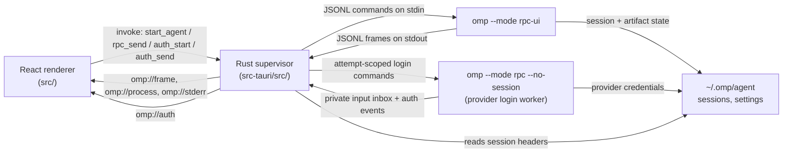

# Architecture

## Process topology



The Rust process is the only process owner. The React layer never spawns
children; it asks the supervisor to start, send to, or stop them.

## Startup

1. `AppShell` calls `bootstrap()` once. `bootstrap` reads `ompd:lastCwd`, or the
   `OMPD_CWD` fallback through `initial_folder`, then calls `connect(cwd)`.
2. Each open session has its own `OmpClient` and isolated Zustand store. Before
   starting the first runtime, the renderer calls `attach_frontend`. Rust waits
   for children from the previous renderer to exit so their session write leases
   are released. All runtimes in the new renderer share the returned owner token.
   `OmpClient.start` passes this token to `start_agent` with `cwd`, optional
   `model`, optional binary override and extra CLI arguments. Rust rejects old
   owner tokens, canonicalizes the path, strips the Windows `\\?\` prefix, and
   spawns an independent child:

   ```
   omp --mode rpc-ui --cwd <path> [--model <model>] [extra…]
   ```

3. Rust takes stdin/stdout/stderr pipes, stores the child behind a tokio mutex,
   emits `started`, and starts three tasks: stdout reader, stderr reader, and a
   500 ms exit monitor.
4. `OmpClient.start` waits up to 45 s for the `ready` frame. On `ready` it sends
   `negotiate_protocol(2)` when advertised and resolves the start.
5. `connect` sends `set_ask_dialog(enabled: true)`, then hydrates with
   `get_state`, `get_messages`, `get_session_stats`,
   `get_available_thinking_levels` and `get_available_commands`, and loads the
   session bucket through Rust `list_sessions`. A separate `get_entries`
   request loads branch metadata without blocking transcript hydration.

## Model catalog

`model-catalog.ts` shares model and role snapshots and in-flight requests across
session stores, keyed by normalized workspace, binary and catalog-relevant CLI
arguments. Each resource has its own success timestamp, loading state and error.
Successful snapshots persist in localStorage with a five-minute freshness window.
Connections and picker opens reuse fresh data; expired data remains usable while
one shared query refreshes it. Manual refresh bypasses freshness but joins an
existing request. Failed refreshes retain the previous data and success timestamp.

Provider login invalidates its catalog context; successful global settings writes
invalidate all contexts. Invalidation advances a revision so earlier queries cannot
publish obsolete results, then refreshes subscribed contexts after any old query
finishes. Workspace changes unsubscribe the runtime from its previous context.
The current agent still validates model selection through `set_model`.

The existing IPC diagnostics measure each CLI query end to end. Native
`catalog_cli_completed` and `catalog_parsed` events separate preparation,
subprocess execution and parsing time without logging paths, arguments or output.

## Provider login

The `/models` provider sidebar retains model availability as a separate
catalog fact. Double-clicking a provider with no available models opens its
login page; a single click still filters the model catalog.

Login runs in a separate attempt-scoped `omp --mode rpc --no-session` child.
The native supervisor supplies a temporary extension and a private extension
input request for login commands, so these commands never become chat prompts.
The extension lists OAuth methods from omp's provider registry and invokes the
same `authStorage.oauth.login` flow as the TUI. Browser URLs and prompts are
forwarded to the page; secrets remain transient and are redacted from auth
events. Cancelling stops the worker. After success, the worker refreshes that
provider's model discovery before the page reloads the CLI model catalog.

## Native configuration

`/settings`, the toolbar and the settings keyboard shortcut open the same
settings surface. `NativeSettings` reads the configured binary, project and
profile through `native_settings`; desktop launcher drafts do not change that
scope until saved.

`settings.rs` queries `omp config list --json` for the complete effective
catalog and `config list --scope global --json` for stored global overrides.
Only global values initialize editable drafts. Project/environment defaults
are descriptive and are never copied into the global layer on opening or
saving an unrelated row. Human `config list` output supplies native category
and enum metadata; format drift falls back to key-prefix groups/text editors
without dropping JSON catalog entries.

`native_setting_write` serializes global mutations and calls native
`config set` or `config reset` with literal argv, native validation and a
30-second timeout. Reset removes one global key. Writes return provenance
labels only, never the CLI's plaintext credential value. Credential drafts
stay blank until explicitly replaced, and subprocess errors are sanitized.
Successful writes refresh effective summaries without discarding other row
drafts. Replaced scopes and stale requests cannot update the current editor.

Changes persist in omp's configuration, independently of the running agent.
The explicit restart action uses the existing session-preserving restart path.
Native terminal appearance settings do not change the desktop renderer.
Config commands do not accept launcher `--config` flags; the editor warns
about that difference and never writes an overlay or project file.


## Embedded terminal

`AppShell` lazy-loads `TerminalPanel` on the first terminal toggle. Its workspace
key unmounts all terminal views when the cwd changes. Hiding the panel or changing
chat sessions leaves the xterm instances and shells alive. Closing a tab disposes
its view and sends an idempotent native close.

`src/lib/terminal/session.ts` creates a UUID and Tauri `Channel` before invoking
`terminal_create`. Create, input, resize and close share an ordered per-session
promise queue; teardown waits for a pending create to avoid orphaning a late
spawn. `terminal.rs` owns the PTYs through `portable-pty`, with independent
blocking reader, writer and child-wait workers. Input has a bounded queue;
dimensions are validated before opening or resizing a PTY.

Output uses raw byte arrays, preserving UTF-8 sequences split between PTY reads.
xterm decodes those bytes and handles ANSI/control sequences; shell output never
enters the chat Markdown renderer. The output worker sends the exit code after
draining output. A `ResizeObserver` and FitAddon synchronize visible terminal
geometry with the PTY; inactive tabs retain their previous size until shown.

Windows shells belong to kill-on-close Job Objects. Unix cleanup signals
descendants and shell/foreground process groups. Tab close, workspace replacement,
channel loss and app exit terminate shells and reap their direct children.
Terminals are independent of omp's RPC process and run with the user's normal
permissions. Shell output is untrusted; no terminal-driven external-link or
clipboard-write handlers are installed.
## Conversation forks

`get_entries` supplies flat persisted entries and the active leaf. `branches.ts`
matches active-path user entries to transcript messages by role, timestamp and
content, including attachments. Alternatives share their nearest preceding
message entry; non-message metadata does not split that group. Nested forks
remain separate. Traversals are iterative for long histories.
It builds the tree locally from parent IDs, avoiding the native JSON decoder's
depth limit on nested `get_tree` responses. Branch metadata refreshes cannot
disable the composer, sending, queue removal or abort controls.

Editing stays local until Save & fork. The store calls same-session
`navigate_tree` on the original user entry with summarization disabled; omp
moves the leaf to its parent without creating a session file or changing
`sessionId`. Only a successful, non-cancelled navigation submits the edited
prompt to the agent through the normal `prompt` RPC command, preserving the
original images. The resulting response and later prompts remain in that
session. Branch arrows navigate directly to a saved descendant leaf,
preferring the current leaf for the active alternative and the newest tail
for inactive alternatives. No local branch database is created. An unanswered
user-only leaf follows omp's draft-restoration behavior.

`branching` locks prompt submission and other session transitions. Branching
also requires idle streaming, background work and queues. Generation and
conversation-revision checks discard stale hydration/navigation results.
After navigation the store clears branch-specific transient UI state and
refreshes messages, tree and session state. Failed prompt submission restores
the edited text and attachments to the composer. An unavailable entries API
reports a warning and leaves edit/branch controls absent.

## Framing

`rpc_frame.rs` implements the protocol-v2 decoder:

- a normal object is passed through;
- `rpc_chunk` frames validate `chunkId`, `index`, `count` and `byteLength`;
- each payload must be canonical base64 and at most 256 KiB;
- indices must be contiguous, the declared byte length must match, and the
  reassembled bytes must be strict UTF-8 JSON;
- a frame arriving mid-sequence, or any mismatch, aborts the sequence.

If the decoder returns a logical frame, Rust emits `omp://frame` with
`{ generation, frame }`. The renderer drops frames whose generation differs from
the active client, which prevents a replaced process from mutating UI state.

## Request correlation

`OmpClient` assigns `ui-N` ids, registers a pending entry, writes the command
through `rpc_send`, and resolves on the `response` frame with that id. Failures
become `RpcFailure` with the RPC `code`. A failure after an acknowledged prompt
arrives as a later `prompt_result` frame instead of a response; the store
surfaces it as a toast and notice.

Extension UI answers are fire-and-forget frames without a response.

## Transcript projection

The store keeps two lists:

- `messages` — committed messages from `get_messages` or completed
  `message_end` frames;
- `pending` — messages currently streaming, keyed by the RPC `messageId`.

`message_start` inserts a pending message, `message_update` replaces it with the
full snapshot the runtime provides, and `message_end` moves it to `messages`
unless a timestamp/role/tool-call key already exists. On `session_settled` (and
after a session change) the store re-reads the full transcript, clears pending,
and deduplicates by the same key.

Tool calls are looked up by `toolCallId`: assistant `toolCall` blocks render a
card with the matching `toolResult`; orphan results render standalone.
`tool_execution_start/update/end` populate a live `toolRuns` map for running
state and partial output. Terminal output is passed through `stripAnsi()`.

## Sessions

A cwd maps to a session bucket exactly as `session-paths.ts` does:
home-relative `-…`, temp-relative `-tmp-…`, otherwise `--<absolute>--`, with
path separators and `:` replaced by `-`. The lister reads at most 32 KiB per
file, folds the fixed-width title slot into the header, keeps the first
non-synthetic user message as preview, and hides untitled sessions with no
prompt (matching the interactive picker).

`list_sessions` discovers the main checkout and linked worktrees through Git,
including branch labels, and returns one chronological feed plus directory
metadata. Pages use an exclusive `(modifiedMs, path)` cursor, with path ordering
breaking timestamp ties. Scope and pinned-path filters apply before pagination.
Global search matches titles, Worktree labels, and message content throughout
the JSONL file; it is not restricted to the summary preview.

Native discovery uses a two-second, per-directory single-flight cache (up to 32
directories); Git errors are not cached. Branch labels and Worktree registrations
can therefore lag external changes by up to two seconds. Session files are still
enumerated on every query, so additions and deletions do not wait for that TTL.
An in-memory LRU cache retains at most 4096 parsed summaries, visibility checks,
and the last full-text query result per file. Entries are validated against file
size and full-resolution modification/creation times, not the millisecond page
cursor. Changed files are reread; snapshots changed during reading are not cached.
No session index is written to disk. New search terms still stream file contents,
preserving bounded memory for oversized JSONL messages. The scanner processes
unescaped ASCII strings in buffered runs; Unicode and JSON escapes retain the
decoded-character matcher, including matches crossing buffer boundaries.

The sidebar has fixed Recent/Running/Pinned controls and a searchable Worktree
popover above an independently scrolling, fixed-row virtualized list. Running
state comes from live runtimes, including background Agent work. Session and
Worktree pins, per-Worktree last sessions, view/scope preferences, and per-view
scroll offsets persist locally. Session pages are cached separately from Agent
runtime state, so selecting another conversation does not reset list navigation.
Search temporarily spans all Worktrees without changing the selected scope.

Selecting a saved session reuses its open runtime, or starts another child in
that session's directory and opens the file with `switch_session`. It never
sends a switch command to another session's running child. Selecting a Worktree
filter restores that Worktree's last conversation; selecting All Worktrees only
changes the list. Opening a session never changes the filter.

Session lookups and sidebar rows use the same path key, including for Windows
verbatim drive and UNC paths. Equivalent spellings reuse the same runtime
while restore is pending and after omp reports its session file.

- New session: start an independent runtime in the active session's Worktree,
  falling back to the last selected Worktree and then the main checkout. Empty
  sessions expose a Worktree selector beside the composer; changing the target
  transfers the unsent draft to a new runtime. The Worktree is always visible
  in the session header and near the composer.
- Switch: select the existing runtime/store; hidden sessions keep processing
  frames, queued messages, tools and dialogs. The stable React store facade
  publishes only the selected store's state. Async actions retain their original
  store/client even when selection changes.
- Open sessions remain accessible across workspaces, including empty sessions.
  Sidebar spinners track background activity; Needs input identifies pending
  extension dialogs. Dialog responses and composer drafts belong to one runtime.
- Native sends and stops require the owning process generation. Each client's
  lifecycle is serialized; all event channels filter by that generation,
  including events received before the start invoke resolves.
- Stop/restart affects the selected runtime only. App exit stops every child.
- Rename: `set_session_name`, then refresh state and the bucket list.
- First prompt auto-title: if the session has no name and no messages, the first
  prompt text (first line, 64 chars) is sent as `set_session_name` after the
  prompt is acknowledged.
- Restart: `restart()` re-spawns only that runtime via `connect`, then reopens
  its remembered `sessionFile` with `switch_session`.
- Runtime relocation (`/wt`, `/move`): both `config_update` and local
  `prompt_result` completion trigger reconciliation. State refreshes query the
  bundled `/ompd-workspace` extension command without relying on session-file
  path changes. It reports `sessionManager.getCwd()` through a reserved status
  key, including for unpersisted empty sessions. Internal query IDs are excluded
  from prompt-result handling to prevent recursive refreshes and changes to the
  user's busy state. The store adopts that cwd without restarting the child or
  clearing the conversation, persists it for restart, and refreshes directory-
  scoped sessions, catalog, and Git status. The extension file lives for the
  child process lifetime; generation filtering rejects old-process updates.

## Git queries

`git_status`, `get_git_changes`, and `get_git_diff` share a native per-directory
snapshot. The bounded 32-directory LRU shares in-flight scans and reuses successful
results for one second after completion; errors are not cached. External changes
can remain absent until this window and the existing UI polling interval expire.
The cache is memory-only and never changes repository configuration or the index.

Repository-root discovery and porcelain-v2 status run concurrently. A single
`diff --raw --numstat -z` supplies tracked paths, rename sources, and net HEAD line
totals with one tree walk. Porcelain-v2 paths remain root-relative for nested
workspaces. Status does not wait for untracked file line counting; changed-file
requests share that lazy enrichment, with at most four Git subprocesses per
snapshot. Binary and oversized files keep null counts. Diff patches are read
fresh, retain literal pathspecs and path/size checks, and reuse only list metadata.

## Composer status

The row below the input shows the current goal status, thinking level, enabled
fast/slow modes, context usage, and extension status marks. The mode slot
appears only while a goal exists, as `/goal` plus its status; the objective
itself stays in the Activity rail. `/prewalk` is not rendered: the installed
runtime does not expose prewalk state through `get_state`, so the client never
infers activation from composer text or notices. TODO.md tracks querying that
state over RPC.

`git_status(cwd)` runs read-only Git commands in Rust with a five-second timeout
and no Windows console window. The active composer refreshes on mount, focus,
turn activity changes, and every ten seconds. Requests are coalesced and results
from replaced connections/workspaces are ignored.

File counts cover the whole repository: staged and unstaged counts can overlap,
conflicts are separate, and untracked files are counted individually. Line totals
compare tracked working files against HEAD (the empty tree for unborn branches);
binary contents and untracked files are excluded. Worktrees and detached HEAD
are supported. Non-repositories and Git failures have distinct labels; failed
refreshes clear old values.


## Failure handling

- Closing stdin lets omp drain accepted commands and exit cleanly. Rust waits 5 s,
  then falls back to `taskkill /PID /T /F` on Windows (or `kill -TERM`
  elsewhere).
- `kill_on_drop(true)` covers ordinary Rust drops.
- The exit monitor exists because tool descendants can inherit stdout and keep
  the pipe open after the agent process is gone; it polls `try_wait()` and emits
  an `exit` event with the code.
- On EOF/exit/read error the client rejects pending requests, emits
  `disconnected`, and the UI shows the restart affordance. A restart preserves
  the last session file.
- `stop_agent` and `start_agent` share a mutex so overlapping invocations cannot
  stop each other's freshly spawned child.

## Extension UI mapping

| RPC method                   | UI                                                       |
| ---------------------------- | -------------------------------------------------------- |
| `select`                     | modal option list                                        |
| `confirm`                    | modal confirm/cancel                                     |
| `input`                      | modal single-line input, optional password type          |
| `editor`                     | modal textarea, submits the edited text                  |
| `ask`                        | questionnaire with multi-select, recommended badge, free text |
| `notify`                     | toast                                                    |
| `setStatus` / `setWidget`    | Activity rail status lines and widget blocks             |
| `setTitle`                   | document title                                           |
| `set_editor_text`            | composer draft                                           |
| `open_url`                   | system opener                                            |
| `cancel`                     | removes the matching dialog                              |

## Diagnostics boundary

`diagnostics.rs` owns subscriber initialization, bounded background output,
profiling capture and shutdown. The managed guard survives child restarts and
flushes after children stop on application exit. It uses the user's home
directory, not the workspace or omp's session-root override.

Frontend native calls import `invoke` from `@/lib/diagnostics`; this preserves
the native API and rejection values while sampling operation-only timing
reports. Global error handlers and the React error boundary report categories
without exception content. `OmpClient` records correlated RPC completion with a
fixed label, without serializing request IDs, command types or response bodies.
Telemetry uses the raw bridge, is bounded and best effort, and cannot recurse.

New commands inherit frontend timing and the shared native dispatch scope.
Feature-specific Rust scopes are optional and reserved for hotspot investigation;
no feature is required to depend on Puffin. Existing live stderr diagnostics are
not a disk logging sink. See README for capture controls and storage.

## Security boundary

The renderer is untrusted with model output: Markdown is rendered through
`react-markdown` without raw HTML, tool output is escaped text, and links are
routed through the Tauri opener instead of in-page navigation. The agent itself
runs as the user, with the permissions of a normal `omp` process; the UI does not
add or remove tool capabilities.

## Verification

- `cargo test --manifest-path src-tauri/Cargo.toml` covers frame reassembly,
  malformed chunk sequences, path encoding and session parsing.
- `bun run build` runs the strict TypeScript check and the production bundle.
- Live checks against a local `omp` instance covered streaming, tool cards,
  edit diffs, steering and follow-up queues, abort, `ask` dialogs, model listing,
  session switching, rename, settings restart and crash recovery.
