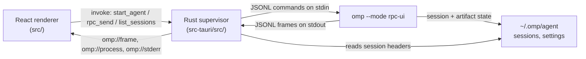

# Architecture

## Process topology



The Rust process is the only process owner. The React layer never spawns
anything; it asks `start_agent` and writes commands through `rpc_send`.

## Startup

1. `AppShell` calls `bootstrap()` once. `bootstrap` reads `ompd:lastCwd`, or the
   `OMPD_CWD` fallback through `initial_folder`, then calls `connect(cwd)`.
2. `OmpClient.start` invokes `start_agent` with `cwd`, optional `model`, optional
   binary override and extra CLI arguments. Rust canonicalizes the path, strips
   the Windows `\\?\` prefix, serializes start calls behind `start_lock`, stops
   any previous child, then spawns:

   ```
   omp --mode rpc-ui --cwd <path> [--model <model>] [extra…]
   ```

3. Rust takes stdin/stdout/stderr pipes, stores the child behind a tokio mutex,
   emits `started`, and starts three tasks: stdout reader, stderr reader, and a
   500 ms exit monitor.
4. `OmpClient.start` waits up to 45 s for the `ready` frame. On `ready` it sends
   `negotiate_protocol(2)` when advertised and resolves the start.
5. `connect` sends `set_ask_dialog(enabled: true)`, then hydrates with
   `get_state`, `get_messages`, `get_session_stats`,
   `get_available_thinking_levels` and `get_available_commands`, and loads the
   session bucket through Rust `list_sessions`.

## Framing

`rpc_frame.rs` implements the protocol-v2 decoder:

- a normal object is passed through;
- `rpc_chunk` frames validate `chunkId`, `index`, `count` and `byteLength`;
- each payload must be canonical base64 and at most 256 KiB;
- indices must be contiguous, the declared byte length must match, and the
  reassembled bytes must be strict UTF-8 JSON;
- a frame arriving mid-sequence, or any mismatch, aborts the sequence.

If the decoder returns a logical frame, Rust emits `omp://frame` with
`{ generation, frame }`. The renderer drops frames whose generation differs from
the active client, which prevents a replaced process from mutating UI state.

## Request correlation

`OmpClient` assigns `ui-N` ids, registers a pending entry, writes the command
through `rpc_send`, and resolves on the `response` frame with that id. Failures
become `RpcFailure` with the RPC `code`. A failure after an acknowledged prompt
arrives as a later `prompt_result` frame instead of a response; the store
surfaces it as a toast and notice.

Extension UI answers are fire-and-forget frames without a response.

## Transcript projection

The store keeps two lists:

- `messages` — committed messages from `get_messages` or completed
  `message_end` frames;
- `pending` — messages currently streaming, keyed by the RPC `messageId`.

`message_start` inserts a pending message, `message_update` replaces it with the
full snapshot the runtime provides, and `message_end` moves it to `messages`
unless a timestamp/role/tool-call key already exists. On `session_settled` (and
after a session change) the store re-reads the full transcript, clears pending,
and deduplicates by the same key.

Tool calls are looked up by `toolCallId`: assistant `toolCall` blocks render a
card with the matching `toolResult`; orphan results render standalone.
`tool_execution_start/update/end` populate a live `toolRuns` map for running
state and partial output. Terminal output is passed through `stripAnsi()`.

## Sessions

A cwd maps to a session bucket exactly as `session-paths.ts` does:
home-relative `-…`, temp-relative `-tmp-…`, otherwise `--<absolute>--`, with
path separators and `:` replaced by `-`. The lister reads at most 32 KiB per
file, folds the fixed-width title slot into the header, keeps the first
non-synthetic user message as preview, and hides untitled sessions with no
prompt (matching the interactive picker).

- New session: `new_session`, then clear local transcript/dialog/session state
  and rehydrate.
- Switch: `switch_session(sessionPath)`, same clearing, same rehydration.
- Rename: `set_session_name`, then refresh state and the bucket list.
- First prompt auto-title: if the session has no name and no messages, the first
  prompt text (first line, 64 chars) is sent as `set_session_name` after the
  prompt is acknowledged.
- Restart: `restart()` re-spawns via `connect`, then reopens the remembered
  `sessionFile` with `switch_session`, so the conversation survives settings
  changes, crashes and manual restarts.

## Failure handling

- Closing stdin lets omp drain accepted commands and exit cleanly. Rust waits 5 s,
  then falls back to `taskkill /PID /T /F` on Windows (or `kill -TERM`
  elsewhere).
- `kill_on_drop(true)` covers ordinary Rust drops.
- The exit monitor exists because tool descendants can inherit stdout and keep
  the pipe open after the agent process is gone; it polls `try_wait()` and emits
  an `exit` event with the code.
- On EOF/exit/read error the client rejects pending requests, emits
  `disconnected`, and the UI shows the restart affordance. A restart preserves
  the last session file.
- `stop_agent` and `start_agent` share a mutex so overlapping invocations cannot
  stop each other's freshly spawned child.

## Extension UI mapping

| RPC method                   | UI                                                       |
| ---------------------------- | -------------------------------------------------------- |
| `select`                     | modal option list                                        |
| `confirm`                    | modal confirm/cancel                                     |
| `input`                      | modal single-line input, optional password type          |
| `editor`                     | modal textarea, submits the edited text                  |
| `ask`                        | questionnaire with multi-select, recommended badge, free text |
| `notify`                     | toast                                                    |
| `setStatus` / `setWidget`    | Activity rail status lines and widget blocks             |
| `setTitle`                   | document title                                           |
| `set_editor_text`            | composer draft                                           |
| `open_url`                   | system opener                                            |
| `cancel`                     | removes the matching dialog                              |

## Security boundary

The renderer is untrusted with model output: Markdown is rendered through
`react-markdown` without raw HTML, tool output is escaped text, and links are
routed through the Tauri opener instead of in-page navigation. The agent itself
runs as the user, with the permissions of a normal `omp` process; the UI does not
add or remove tool capabilities.

## Verification

- `cargo test --manifest-path src-tauri/Cargo.toml` covers frame reassembly,
  malformed chunk sequences, path encoding and session parsing.
- `bun run build` runs the strict TypeScript check and the production bundle.
- Live checks against a local `omp` instance covered streaming, tool cards,
  edit diffs, steering and follow-up queues, abort, `ask` dialogs, model listing,
  session switching, rename, settings restart and crash recovery.
